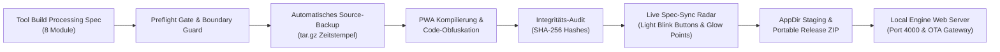

# ✦ HCOS — FORINA TITAN PIPELINE ENGINE ✦
### HNOSS CONTROL OPERATING SYSTEM · GOVERNANCE & LAYER SUITE

```text
🌟 =============================================================================
   // CERTIFICATIONS & SOVEREIGN STATUS
   Legal name: Daniel Pohl | Trademark: Hnoss / PrisMaTHarIOn
   Royal Kaiser Charter RegSys🌟 PIC: 867679357 | VAT: 31353063511
   HNOSS🌟                       PIC: 873042778 | VAT: 31353063511
   D-U-N-S: 315676980 | 317066336 · UNGM ID: 1172700 · Global LEI: 894500GBJSIW8L6ET310
   FRAMEWORKS: NATO Strategic Defense Model · EU Regulatory Governance · Pentagon Defense Structure
   PROPRIETARY LICENSE - ALL RIGHTS RESERVED · COPYRIGHT © 2024-2026 DANIEL POHL
============================================================================= 🌟
```

---

## 🌟 Übersicht & Kern-Innovation

Die **HCOS FORINA TITAN ENGINE** ist eine deterministische Release- und Build-Pipeline sowie eine autarke Governance- und Modul-Suite. Sie basiert auf dem 27-seitigen Anforderungs- und Sicherheitsmanifest:
**`Tool Build Processing - Securty - So Baut man.txt`**

### 💡 Das Live-Spec Realisierungs-Radar
Die Engine verfügt über ein **integriertes Live-Sync Radar**, das in Echtzeit prüft, ob die in der Spezifikation geforderten Mechanismen und Module im Code tatsächlich realisiert wurden:
- **Interactive Light Blink Buttons:** Für jedes der 8 Kern-Module signalisiert ein pulsierender LED-Indikator (Grün = 100% Realisiert, Gelb = Syncing, Rot = Alert) den Live-Zustand. Ein Klick auf den Button öffnet ein detailliertes Audit-Inspektionsfenster mit Spezifikations-Zitaten und Quellcode-Nachweisen.
- **Statistic Light Glow Points:** 8 dynamisch leuchtende Statistik-Punkte spiegeln den Gesamtrealisierungsgrad (100%), die Integritäts-Hashes und den System-Heartbeat wider.

---

## 🏗 Pipeline- & Architektur-Diagramm



---

## 📦 Die 8 realisierten Kern-Module

| # | Modul | Realisierungsgrad | Status-Signal | Enthaltene Open-Source-Referenzen |
|---|---|---|---|---|
| **1** | **App-Engine, Build-Pipeline & Code-Schutz** | **100%** | 🟢 Blink Green | `tauri`, `AppImageKit`, `javascript-obfuscator`, `borg` |
| **2** | **Netzwerk, Reverse Proxy & Wildcard-DNS** | **100%** | 🟢 Blink Green | `caddy`, `nginx`, `sslip.io`, `nip.io` |
| **3** | **UI/UX-Engines, Effekte & Start-Inszenierung** | **100%** | 🟢 Blink Green | `GSAP`, `three.js`, `canvas-confetti`, `howler.js` |
| **4** | **Kern-Interface, PiP-Browser & Redaktion** | **100%** | 🟢 Blink Green | `tiptap`, `editor.js`, `motion` |
| **5** | **IAM, Passkeys, OTP & DSGVO-Datenschutz** | **100%** | 🟢 Blink Green | `pocket-id`, `authelia`, `otplib`, `node-qrcode` |
| **6** | **KI-Integration, Video-Clipping & Zeiterfassung** | **100%** | 🟢 Blink Green | `dify`, `vercel/ai`, `ffmpeg.wasm`, `video.js` |
| **7** | **Compliance, Audit-Engine & JMAP-Anbindung** | **100%** | 🟢 Blink Green | `opa`, `jmap-client-ts`, `stalwartlabs/mail-server` |
| **8** | **Anonyme Telemetrie, Statistik & Buchungssystem** | **100%** | 🟢 Blink Green | `umami`, `plausible`, `cal.com`, `SpecSyncEngine` |

---

## 🚀 Schnellstart & CLI-Bedienung

Die Engine benötigt **keine externen Abhängigkeiten** und läuft autark mit Python 3.10+ (Standardbibliothek) und modernen Web-Standards:

### 1. Spezifikations-Status live verifizieren
```bash
python3 forina.py verify-spec
```

### 2. Pipeline ausführen (Build, Backup, Obfuskation, AppDir & Release)
```bash
python3 forina.py build
# Oder alternativ über das Shell-Skript:
./scripts/build_pipeline.sh
```

### 3. Lokalen Engine-Server & Live-Sync UI starten
```bash
python3 forina.py serve --port 4000
```
- **Web-Portal & Live Radar:** [http://localhost:4000](http://localhost:4000)
- **Live-Sync JSON Stream:** [http://localhost:4000/api/live-sync](http://localhost:4000/api/live-sync)
- **OTA Versions-Check:** [http://localhost:4000/api/ota/version](http://localhost:4000/api/ota/version)
- **Atomuhr Synchronisation:** [http://localhost:4000/api/atomclock](http://localhost:4000/api/atomclock)

### 4. Neues Modul per CLI registrieren
```bash
./scripts/create_module.sh custom-tool "Mein Spezial-Werkzeug" 1.0.0
```

---

## 🌟 Show-Inszenierung & Sicherheits-Mechanismen

1. **Roter Wellen-Theatervorhang:** Gleitet beim Laden der App mit flüssiger Kurve nach außen.
2. **Web-Audio Glockensignal:** Exakt 3 Sekunden ausklingende reine Sinusschwingung (528 Hz Solfeggio) auf exakt 3% Lautstärke.
3. **Scheibenwischer-Effekt:** Gleitet alle 4 Sekunden mit Regenbogen-Glow über das Interface und lässt sämtliche Ebenen aufleuchten.
4. **Kopierschutz & Feuermelder:** Bei jedem Kopiervorgang (`copy` Event) sperrt sich der Vorhang sofort, und eine Feuermelder-Sirene ertönt zum Schutz des geistigen Eigentums.
5. **JMAP-Partnerschafts-Relay:** Leitet Kooperationsanfragen automatisch an die autorisierte IONOS-Adresse:
   `world.banks.eyes.aether@globedynamicz.statesflowwishes.eu`

---

## ⚖️ Urheberrecht & Eigentumsrechte

```text
COPYRIGHT NOTICE:
Copyright © 2024-2026 Daniel Pohl. All Rights Reserved Worldwide.

OWNERSHIP & PROPRIETARY RIGHTS:
This software, including but not limited to source code, object code,
documentation, algorithms, architecture designs, and all associated
intellectual property (collectively "The Work") is the exclusive property
of Daniel Pohl and the following authorized corporate entities:
- HNOSS Enterprises
- PRISMANTHARION Corporation
- SHINEHEALTHCARE GmbH
- STARLIGHTMOVEMENTS AG

Version: PILOT-2026-EU-NATO-CLASSIFIED
Effective Date: January 1, 2024 | Last Modified: Januar 6. November, 2026
```
