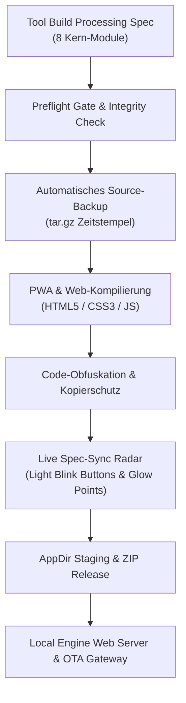

# HCOS FORINA TITAN · ARCHITEKTUR & PIPELINE ENGINE

## Pipeline-Architektur

## Schichtenmodell

1. **Präsentations-Ebene (`web/`):**
   - Titan-Design, metallische Farbverläufe, GSAP-Animationsabläufe, Three.js Effekte.
   - Offline-First PWA mit Service Worker (`sw.js`) und Web-Manifest.
   - Interaktive Light Blink Buttons und Statistic Glow Points.
2. **Engine & Pipeline-Ebene (`forina_engine/`):**
   - Deterministischer Build-Orchestrator (`engine.py`).
   - Spezifikations-Parser und Live-Sync Verifizierer (`spec_sync.py`).
   - Unified HTTP/API Server (`server.py`).
3. **Infrastruktur & Routing (`config/`):**
   - Caddy & NGINX Reverse Proxy Konfigurationen mit automatischer DNS-Auflösung via sslip.io / nip.io.
4. **Compliance & Nachweisführung (`releases/`, `docs/`):**
   - SHA-256 Prüfsummen-Inventar.
   - Audit Evidence JSON Berichte.
