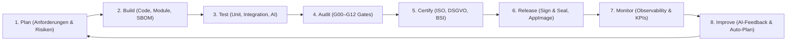

# HCOS FORINA TITAN ENGINE — CONCEPT PAPER SUITE v2.0
## Masterkonzept: 33+ A4 Concept Papers für Architektur, Implementierung, Web3, Finance & Compliance

**Dokumentenstand:** Version 2.0 — 06. November 2026  
**Herausgeber & Urheberrecht:** Daniel Pohl, Royal Kaiser Charter RegSys  
**EU UNION AI PACT:** https://github.com/EU-UNION-AI-PACT/HCOS-FORINA-TITAN-ENGINE  
**Rechtliche Provenienz:** PIC: `867679357`, USt-IdNr.: `DE31353063511`, D-U-N-S: `315676980` & `317066336`, Global LEI: `894500GBJSIW8L6ET310`, UNGM: `1172700`

---

## 🏛️ Übersicht der 34 A4 Concept Papers

| Nr | Titel des Concept Papers | Kürzel / Tags | Relevante Module | Normen & Standards |
|---|---|---|---|---|
| **01** | **Executive Summary & Vision 2030** | `VIS, STR, EU` | M01–M13 | EU AI Act, DSGVO |
| **02** | **Gesamtarchitektur HCOS FORINA TITAN** | `ARCH, M01-M13` | M01–M13 | ISO 27001, BSI IT-Grundschutz |
| **03** | **Modul-Matrix M01–M13 (Funktion & DAG)** | `MOD, DAG` | M01–M13 | ISO 9001, IEC 62443 |
| **04** | **IA – Intelligent Automation Framework** | `IA, RPA, AGT` | M01, M05 | EU AI Act, ISO 22989 |
| **05** | **XD – eXperience Design & Sovereign UI/UX** | `XD, UX, UI` | M03 | EN 301 549, WCAG 2.2 (#121212 & #FFD700) |
| **06** | **50-Repository Ökosystem (Zonen & Integration)** | `REPO, ZON, INT` | M01–M13 | SPDX, Open Source Governance |
| **07** | **Entwicklungsumgebung & DevSecOps** | `DEV, CI/CD` | M02 | SBOM, SLSA Level 4, GitOps |
| **08** | **Harness-Loop: Automatischer Umsetzungs- & Audit-Loop** | `LOOP, HNL` | M02, M12 | Act Pack Zero Clock, ISO 20000-1 |
| **09** | **Security Architecture & Zero-Trust Model** | `SEC, ZT, IAM` | M04, M07 | NIST SP 800-207, BSI CS 134 |
| **10** | **Netzwerkisolation & Air-Gap (Sovereign Mode)** | `AIR, NET, G03` | M07, M10 | BSI IT-Grundschutz INF.1, Gate G03 |
| **11** | **Datenhaltung, Verschlüsselung & Schlüsselmanagement** | `ENC, KMS, HSM` | M04, M13 | BSI TR-02102, FIPS 140-3, AES-256-GCM |
| **12** | **Blockchain-Architektur & On-/Off-Chain-Integration** | `BC, DLT, SC` | M07, M12 | ISO 23257, EVM, Smart Contracts |
| **13** | **Crypto-Implementation (Signaturen, Wallets, ZKP)** | `CRYPTO, ED25519` | M04, M12 | RFC 8032 (Ed25519), ZK-SNARKs |
| **14** | **Web3-Anwendungen & Dezentralisierung** | `WEB3, DID, VC` | M04, M09 | W3C DID, Verifiable Credentials, eIDAS 2.0 |
| **15** | **Finance-Implementation (Payments, DeFi, Escrow)** | `FIN, PAY, DEFI` | M08 | PSD2, ISO 20022, Zero-Settlement |
| **16** | **Rechenmodelle, Tokenisierung & Asset-Management** | `RWA, TOKEN, NFT` | M08, M12 | MiCA, ERC-3643 (RWA Compliance) |
| **17** | **Datenschutz & DSGVO-Compliance** | `DSGVO, DPA, PIA` | M04, M10 | DSGVO Art. 25/32, DPIA, ePrivacy |
| **18** | **Normen & Standards (ISO, IEC, EN, BSI, NIST)** | `ISO, IEC, EN` | Alle | ISO 27001, ISO 9001, IEC 62443, EN 50600 |
| **19** | **Zertifizierungen & Abzeichen (Kriterien & Prozesse)** | `CERT, AUD, BADGE` | M12 | TISAX, BSI-Grundschutz, CIS Controls |
| **20** | **Automatisierte Audit- & Abnahme-Pipeline** | `AUDIT, G00-G12` | M12 | 13-Gate Pipeline, Nonce-Verification |
| **21** | **Daten-Governance & Data Lifetime Management** | `DGM, RET, ERASE` | M06, M10 | DIN 66399, Right to be forgotten |
| **22** | **Interoperabilität & Integrationen (APIs, Protokolle)** | `API, OIDC, SSO` | M01, M09 | REST, gRPC, WebSocket, JMAP |
| **23** | **Identität, Zugriff & Föderation (SSO, OIDC, SAML)** | `IAM, OIDC, FED` | M04 | OIDC, SAML 2.0, Passkeys (FIDO2) |
| **24** | **Monitoring, Observability & Incident Response** | `OBS, SIEM, IR` | M10, M13 | OpenTelemetry, Prometheus, SIEM |
| **25** | **Business Continuity, Backup & Disaster Recovery** | `BCP, DR, RTO/RPO` | M13 | ISO 22301, Borg Deterministic Backup |
| **26** | **Legal, Lizenzierung & Open-Source-Governance** | `LIC, SPDX, OSS` | M01, M02 | SPDX 3.0, Dual-Licensing, IP Compliance |
| **27** | **Risikomanagement & Threat Modeling** | `RISK, TMT, TVM` | M07, M13 | STRIDE, LINDDUN, MITRE ATT&CK |
| **28** | **Performance, Skalierung & Ressourcen-Management** | `PERF, SCALE, K8S` | M02, M05 | WebAssembly, Multi-Threading, Low-Memory |
| **29** | **KI/LLM-Integration (BOBA, Stroq, RAG, Guardrails)** | `LLM, RAG, SAFE` | M05, M06, M12, M13 | BOBA-Bench, Stroq Scanner, OWASP LLM Top 10 |
| **30** | **Nachhaltigkeit & Green IT (ESG, CSRD)** | `ESG, GREEN, CO2` | M02, M08 | CSRD, GHG Protocol, Eco-Design |
| **31** | **Betrieb, Wartung & Lifecycle-Management** | `OPS, LCM, SRE` | M02, M12 | SRE Best Practices, Zero-Downtime |
| **32** | **Roadmap, Meilensteine & Release-Strategie** | `ROAD, MILE, REL` | Alle | SemVer, Release Sign & Seal, PWA/AppImage |
| **33** | **Abnahme, Zertifizierung & Continuous Compliance** | `CC, ISO, LOOP` | M12 | Kontinuierliche Audit-Automatisierung |
| **34** | **Anhang: Abkürzungen, Keywords & Glossar (33+)** | `A-Z, KW, DEF` | Alle | Vollständiges Referenzglossar |

---

## 🔄 Der Automatisierte Harness-Loop (End-to-End Zyklus)

Der **Automated Harness Loop** ist ein rekursiver, deterministischer Kontrollzyklus für alle Artefakte der Engine:

---

## 📜 Zertifizierungs- und Normenmatrix

- **Sicherheitsmanagement:** ISO/IEC 27001:2022
- **Qualitätsmanagement:** ISO 9001:2015
- **IT-Service-Management:** ISO/IEC 20000-1:2018
- **Business Continuity:** ISO 22301:2019
- **Industrielle Sicherheit (OT):** IEC 62443-4-1 / 4-2
- **Rechenzentren:** EN 50600
- **BSI IT-Grundschutz:** Bausteine INF, NET, SYS, APP, CON
- **Automotive:** TISAX (Level 3 AL3 AL2)
- **Internationale Standards:** NIST Cybersecurity Framework 2.0, CIS Controls v8
- **Europäische Richtlinien:** DSGVO (GDPR), eIDAS 2.0, NIS2, DORA, MiCA, CSRD/ESRS
