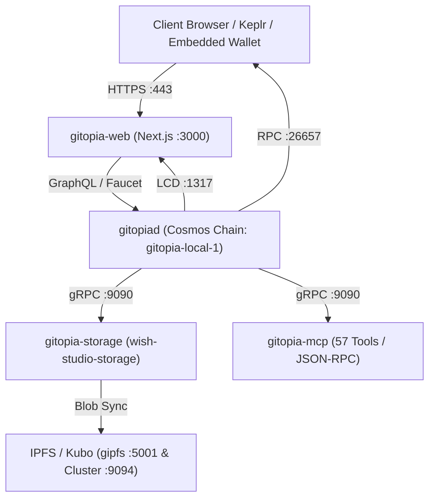

# WISH STUDIO OS · VPS ARCHITEKTUR & TOOL-REGISTRY
**System:** Wish Studio OS · VPS `82.165.134.41` (Ubuntu 26.04) · Stand: 30.10.2026  
**Container-Ökosystem:** ~110 Docker-Container · Traefik HTTPS (:443) Reverse Proxy  
**Sovereign Governance:** Daniel Pohl · Royal Kaiser Charter RegSys  
**Quellenmatrix:** `docs/catalogs/WISH_STUDIO_VPS_34_PORTALS.csv` & `docs/catalogs/WISH_STUDIO_18_REPOS.csv`

---

## 1. Übersicht der 34 Öffentlichen Portale

Alle Endpunkte werden sicher über Traefik mit Let's Encrypt TLS und `sslip.io`-Domains bereitgestellt:

| # | Tool | Öffentliche URL | Native API / Scope |
|---|------|-----------------|--------------------|
| 1 | Platform-Launchpad | `https://platform.82-165-134-41.sslip.io` (Alias `portal.`) | `/health` · Dashboard |
| 2 | Gitopia Web | `https://gitopia.82-165-134-41.sslip.io` | `/api/graphql` · `/api/faucet` · `/explorer` |
| 3 | Gitopia LCD API | `https://gitopia-api.82-165-134-41.sslip.io` | `/cosmos/**` · `/gitopia/**` |
| 4 | Gitopia RPC | `https://gitopia-rpc.82-165-134-41.sslip.io` | `/status` · `/websocket` |
| 5 | Gitopia Storage | `https://storage.gitopia.82-165-134-41.sslip.io` | `POST /v1/blobs` · `/v1/trees` · `/v1/commits` |
| 6 | Gitopia MCP | `https://mcp.gitopia.82-165-134-41.sslip.io` | JSON-RPC `POST /` (57 Tools) |
| 7 | Storage-Explorer | `https://storage-explorer.82-165-134-41.sslip.io` | LCD `gitopia/storage` |
| 8 | Chain-Registry | `https://gitopia.82-165-134-41.sslip.io/keplr/gitopia-local-1/chain.json` | Statisch (Keplr Integration) |
| 9 | Ditto (Nostr) | `https://ditto.82-165-134-41.sslip.io` (Alias `nostr.`) | Nostr WS-Relays |
| 10 | Huly | `https://huly.82-165-134-41.sslip.io` | `/_accounts` · `/_transactor` |
| 11 | Fider | `https://fider.82-165-134-41.sslip.io` | `/api/v1/posts` |
| 12 | Zammad | `https://zammad.82-165-134-41.sslip.io` | `/api/v1/users/me` · `/api/v1/**` |
| 13 | Chatwoot | `https://chatwoot.82-165-134-41.sslip.io` | `/api/v1/**` |
| 14 | Twenty CRM | `https://twenty.82-165-134-41.sslip.io` | `/graphql` · `/healthz` |
| 15 | Teable | `https://teable.82-165-134-41.sslip.io` | `/api/space` · `/api/**` |
| 16 | Listmonk | `https://listmonk.82-165-134-41.sslip.io` | `/api/lists` · `/api/**` |
| 17 | DocuSeal | `https://docuseal.82-165-134-41.sslip.io` | `/api/templates` |
| 18 | Documenso | `https://documenso.82-165-134-41.sslip.io` | `/api/health` |
| 19 | Cal.com | `https://cal.82-165-134-41.sslip.io` | `/api/version` · `/api/**` |
| 20 | AFFiNE | `https://affine.82-165-134-41.sslip.io` | `/graphql` |
| 21 | Dify AI | `https://dify.82-165-134-41.sslip.io` | `/console/api/setup` · `/v1` |
| 22 | Kodus AI | `https://kodus.82-165-134-41.sslip.io` | `/health` |
| 23 | OmniRoute | `https://omniroute.82-165-134-41.sslip.io` | `/v1` |
| 24 | 0Router | `https://0router.82-165-134-41.sslip.io` | `/v1` |
| 25 | SonarQube | `https://sonar.82-165-134-41.sslip.io` | `/api/system/status` |
| 26 | DefectDojo | `https://defectdojo.82-165-134-41.sslip.io` | `/api/v2/` |
| 27 | DepTrack | `https://dtrack.82-165-134-41.sslip.io` | `/api/version` |
| 28 | Infisical | `https://infisical.82-165-134-41.sslip.io` | `/api/status` |
| 29 | Presidio Analyzer | `https://presidio-analyzer.82-165-134-41.sslip.io` | `/health` · `/analyze` |
| 30 | Presidio Anonymizer | `https://presidio-anonymizer.82-165-134-41.sslip.io` | `/health` · `/anonymize` |
| 31 | Qualle ML | `https://qualle.82-165-134-41.sslip.io` | `/docs` · `/predict` |
| 32 | Arcane | `https://arcane.82-165-134-41.sslip.io` | API Management |
| 33 | SingleStore Studio | `https://singlestore.82-165-134-41.sslip.io` | Cluster UI |
| 34 | Orbit GKG | `https://orbit.82-165-134-41.sslip.io` | `:9394` Graph Knowledge Gateway |

---

## 2. Gitopia Full-Stack & Sovereign On-Chain Map

### Verifizierte On-Chain Identitäten:
- **Chain-ID:** `gitopia-local-1`
- **Default User:** `wishuser` (`gitopia1cp3nms9j8nv2803gwxh2m0kt8qugvdfpw35f3t`)
- **Initiales Repository:** `awesome-project` (ID `0`, Owner `wishuser`, Default-Branch `master`)
- **Storage Provider:** `wish-studio-storage` (Stake `1e12 ulore`, on-chain aktiv)
- **Token Faucet:** `10 utlore` pro Request via `/api/faucet`

---

## 3. Interne Backend-Dienste (Air-Gapped / Localhost Only)

Folgende Datenbanken und Message-Broker sind strikt vom WAN isoliert (Gate G03 konform):
- `singlestore-memsql`: `127.0.0.1:3306`
- `orbit-clickhouse`: `127.0.0.1:8123`
- `orbit-nats`: `127.0.0.1:4222`
- `gipfs`: `127.0.0.1:5001` / `127.0.0.1:8080`
- `gipfs-cluster`: `127.0.0.1:9094`
- `zammad-backend`: `127.0.0.1:18080`
