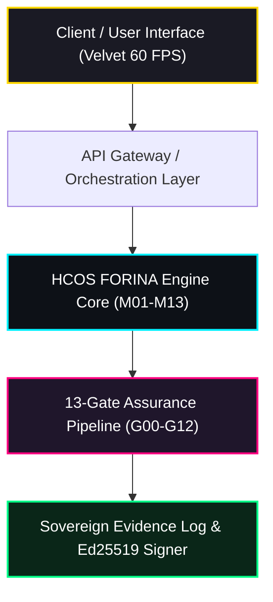

# HCOS FORINA TITAN ENGINE — CONCEPT PAPER #16
## Rechenmodelle, Tokenisierung & Asset-Management
**Dokumenten-Code:** `RWA, TOKEN, NFT` | **Kategorie:** Finanzen & Zahlungsverkehr  
**Version:** 2.0 (Masterkonzept) — 06. November 2026  
**Urheberrecht & Provenienz:** Daniel Pohl, Royal Kaiser Charter RegSys  
**EU UNION AI PACT:** https://github.com/EU-UNION-AI-PACT/HCOS-FORINA-TITAN-ENGINE  
**Rechtliche Registrierung:** PIC: `867679357` | USt-IdNr.: `DE31353063511` | D-U-N-S: `315676980` & `317066336` | Global LEI: `894500GBJSIW8L6ET310` | UNGM: `1172700`

---

### 1. Executive Summary & Mission
Rechtskonforme Tokenisierung realer Vermögenswerte (Real World Assets - RWA) und institutionelles Treasury Management.

Dieses Dokument ist integraler Bestandteil der **34 A4 Concept Papers Suite** der HCOS FORINA TITAN ENGINE. Es definiert die normativen, architektonischen und technischen Anforderungen für die Implementierung und den souveränen Betrieb.

---

### 2. Regulatorische Einbettung & Normenkonformität
| Anforderungsbereich | Relevante Normen & Standards | Zielmodule im Engine-Core |
|---|---|---|
| **Sicherheits- & Rechtsrahmen** | EU Markets in Crypto-Assets (MiCA) · ERC-3643 Permissioned Tokens · eWpG (Elektronisches Wertpapiergesetz) | `M08, M12` |
| **Audit-Verifikation** | 13-Gate HCOS Assurance (G00–G12) | M12 (Assurance Engine), M13 (Scanner) |
| **Netzwerk-Isolation** | Gate G03 Sovereign Air-Gap Guard | M07 (Policy), M10 (Analytics) |

---

### 3. Kern-Schwerpunkte & Architektur-Spezifikation
- **ERC-3643 Permissioned Token Standard mit automatischer Identitätsprüfung (Identity Registry)**
- **Lifecycle-Management von RWA (Emission, Zinszahlung, Tilgung)**
- **ESG-konforme Nachhaltigkeits-Tokens mit Zertifikatsbindung**
- **MiCA-konforme Custody-Verwaltung**

---

### 4. Technische Implementierungs-Richtlinien & Interfaces
- Smart Contract Suite: Modulare Verträge für Compliance, Transfer-Restriktionen und Asset-Tracking
- Whitelisting: Transaktionen sind nur zwischen erfolgreich KYC/AML-verifizierten Wallets zulässig
- Valuation Engine: Automatisierte Bewertung basierend auf dezentralen Preisorakeln
- Rechtliche Verankerung: Elektronische Wertpapieremission nach deutschem eWpG und EU MiCA

#### 4.1 Interface & Datenfluss-Modell

#### 4.2 Fail-Closed Sicherheitsgarantie
Sollte während der Ausführung oder des Audits eine Abweichung von den in diesem Papier definierten Parametern auftreten, greift das **Fail-Closed Prinzip**:
1. Sofortiger Stopp aller aktiven Workflows.
2. Protokollierung des Kausalitätsbaums via WhyTrace.
3. Entzug der Zertifikatsfreigabe (Status `HALTED`).
4. Erneute Validierung erst nach erfolgreicher Behebung im nächsten Durchlauf des **Harness-Loops**.

---

### 5. Kryptografische Evidenz & Souveräne Signatur
- **Signatur-Verfahren:** Ed25519 (RFC 8032)
- **Hash-Algorithmus:** SHA-256 (FIPS 180-4)
- **Audit-Verankerung:** HCOS Evidence Store (`evidence-*.json`)
- **Urheber-Signatur:** Daniel Pohl (Royal Kaiser Charter RegSys)
