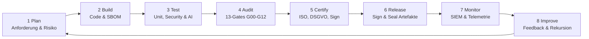

# HCOS FORINA TITAN ENGINE — CONCEPT PAPER #34
## Anhang: Abkürzungen, Keywords & Glossar (33+)
**Dokumenten-Code:** `A-Z, KW, DEF` | **Kategorie:** Glossar & Referenz  
**Version:** 2.0 (Masterkonzept) — 06. November 2026  
**Urheberrecht & Provenienz:** Daniel Pohl, Royal Kaiser Charter RegSys  
**EU UNION AI PACT:** https://github.com/EU-UNION-AI-PACT/HCOS-FORINA-TITAN-ENGINE  
**Rechtliche Registrierung:** PIC: `867679357` | USt-IdNr.: `DE31353063511` | D-U-N-S: `315676980` & `317066336` | Global LEI: `894500GBJSIW8L6ET310` | UNGM: `1172700`

---

### A. Entwicklung — 33+ Schlüssel-Abkürzungen (Normatives Glossar)

| Kürzel | Bedeutung | Fachbereich | Relevanz im System |
|---|---|---|---|
| **IA** | Intelligent Automation | KI & Orchestrierung | Agenten-Orchestrierung, autonomes Reasoning & Tool-Synthese |
| **XD** | eXperience Design | Frontend & UI/UX | Souveräne Ästhetik (#121212 & #FFD700), Velvet 60 FPS Easing |
| **RAG** | Retrieval-Augmented Generation | KI / Semantic Search | 128-1024 Dim Vector-Store Einbindung ohne Halluzinationen |
| **LLM** | Large Language Model | KI & Modelle | Lokale & souveräne Sprachmodelle mit Guardrails |
| **DAG** | Directed Acyclic Graph | Architektur | Zyklenfreie Modul-Abhängigkeitsmatrix (M01–M13) via DFS |
| **CI/CD** | Continuous Integration / Continuous Delivery | DevSecOps | Automatisierte, reproduzierbare Build- und Test-Pipelines |
| **IaC** | Infrastructure as Code | DevSecOps | Deklarative Umgebungsdefinition ohne manuelle Konfiguration |
| **SbC** | Security by Code | DevSecOps | Automatisiertes Durchsetzen von Sicherheitsregeln im Quelltext |
| **SAST** | Static Application Security Testing | DevSecOps | Statische Quellcodeanalyse vor der Kompilierung |
| **DAST** | Dynamic Application Security Testing | DevSecOps | Dynamische Laufzeitanalyse von Schnittstellen & Speicher |
| **OIDC** | OpenID Connect | Identity / IAM | Dezentrale Identitäts- und Authentifizierungsschicht |
| **SAML** | Security Assertion Markup Language | Identity / IAM | Enterprise Single Sign-On (SSO) Föderationsstandard |
| **SC** | Smart Contract | Blockchain / DLT | Deterministische On-Chain Programmlogik |
| **DLT** | Distributed Ledger Technology | Blockchain / Web3 | Dezentrale, manipulationssichere Registerführung |
| **ZKP** | Zero-Knowledge Proof | Kryptografie | Mathematischer Nachweis von Eigenschaften ohne Datenpreisgabe |
| **DID** | Decentralized Identifier | Web3 / Identity | W3C Standard für kryptografisch beweisbare Eigen-Identitäten |
| **DeFi** | Decentralized Finance | Web3 / Finance | Dezentrale Finanzprotokolle, Swaps und Liquiditätspools |
| **RWA** | Real World Asset | Finance / Token | Tokenisierung physischer Werte nach ERC-3643 & MiCA |
| **KMS** | Key Management Service | Kryptografie | Sichere Generierung, Speicherung und Rotation von Schlüsseln |
| **HSM** | Hardware Security Module | Hardware-Sicherheit | FIPS 140-3 zertifizierte Krypto-Hardware zur Schlüsselisolation |
| **SIEM** | Security Information and Event Management | Observability | Zentrales Echtzeit-Sicherheitsmonitoring und Log-Korrelation |
| **RTO** | Recovery Time Objective | Business Continuity | Maximale Zeit bis zur Wiederherstellung (< 60 Sekunden) |
| **RPO** | Recovery Point Objective | Business Continuity | Maximaler tolerierbarer Datenverlust (0 Sekunden bei Sync) |
| **BCM** | Business Continuity Management | Betrieb & Resilienz | ISO 22301 konformes Notfall- und Krisenmanagement |
| **DSGVO** | Datenschutz-Grundverordnung | EU-Recht | Europäisches Datenschutzrecht (Art. 25, 32 TOMs) |
| **NIS2** | Network and Information Security Directive 2 | EU-Recht | Strengere Cybersicherheitsanforderungen für kritische Dienste |
| **DORA** | Digital Operational Resilience Act | EU-Recht | Digitale operationale Resilienz für Finanzunternehmen |
| **eIDAS** | Electronic Identification, Authentication & Trust Services | EU-Recht | EU-Verordnung für elektronische Signaturen und EUDIW |
| **ESG** | Environmental, Social, and Governance | Nachhaltigkeit | Nachhaltigkeitskriterien für Green IT und Green Coding |
| **CSRD** | Corporate Sustainability Reporting Directive | Nachhaltigkeit | Verpflichtende EU-Nachhaltigkeitsberichterstattung |
| **TOM** | Technische & Organisatorische Maßnahmen | Compliance | Konkrete Sicherheitsvorkehrungen gemäß DSGVO Art. 32 |
| **ISO** | International Organization for Standardization | Standardisierung | Weltweiter Verband für Qualitäts- und Sicherheitsnormen |
| **IEC** | International Electrotechnical Commission | Standardisierung | Internationale Normen für elektrische und elektronische IT |
| **BSI** | Bundesamt für Sicherheit in der Informationstechnik | Nationale Behörde | Deutscher Standard für IT-Grundschutz und Kryptorichtlinien |
| **CIS** | Center for Internet Security | Best Practices | International anerkannte Härtungsrichtlinien (CIS Controls) |
| **TISAX** | Trusted Information Security Assessment Exchange | Automotive | Strenger Sicherheitsstandard der europäischen Automobilindustrie |

---

### B. 33+ Kern-Keywords (Thematische Fachmatrix)

#### 1. Blockchain & DLT
- **Blockchain:** Dezentrale Kette kryptografisch verknüpfter Blöcke.
- **DLT (Distributed Ledger):** Verteilte Kontenführung über mehrere unabhängige Knoten.
- **Node:** Validierender oder archivierender Netzwerkknoten.
- **Smart Contract:** Turing-vollständiges Skript auf DLT-Ebene.
- **Tokenisierung:** Abbildung von Rechten oder Werten auf digitale Token.
- **On-/Off-Chain:** Trennung zwischen transparenter Registerführung und geschützter lokaler Datenhaltung.
- **Layer-1 / Layer-2:** Basisschicht (L1) und Skalierungs-Rollups (L2).
- **Interoperabilität:** Cross-Chain Kommunikation über standardisierte Brücken.
- **Cross-Chain:** Protokollübergreifende Transaktionen zwischen heterogenen DLTs.
- **Oracles:** Sichere Datenzulieferer von Off-Chain Realweltdaten.
- **Immutable Log:** Unveränderbares Prüfprotokoll für Auditoren.
- **Merkle Tree:** Baumstruktur zur kryptografisch effizienten Verifikation großer Datenmengen.
- **RWA (Real World Assets):** Tokenisierte Immobilien, Anleihen oder Rohstoffe.

#### 2. Kryptografie
- **Ed25519:** Schnelle und sichere Signatur über Edwards-Curve 25519 (RFC 8032).
- **X.509:** Standard für digitale Public-Key-Zertifikate.
- **Verschlüsselung (AES-256-GCM):** Authentifizierte symmetrische Verschlüsselung.
- **Digital Signature:** Mathematisches Verfahren zum Nachweis von Urheberschaft und Unverfälschtheit.
- **Key Rotation:** Regelmäßiger automatisierter Austausch kryptografischer Schlüssel.
- **HSM / TPM:** Hardware-Sicherheitsmodule und Trusted Platform Modules.
- **Kryptografie:** Gesamtheit aller Methoden zur Informationssicherheit.
- **Hash (SHA-256):** Einwegfunktion zur Bildung eindeutiger digitaler Fingerabdrücke.
- **Zero-Knowledge (ZKP):** Beweis ohne Enthüllung geheimer Eingangsparameter.
- **PKI / CA:** Public-Key-Infrastruktur und vertrauenswürdige Zertifizierungsstellen.
- **Wallet (MPC):** Schwellwert-Signatur-Geldbörse ohne Single Point of Failure.
- **KYC / KYB:** Know Your Customer / Business Verifikationsprozesse.

#### 3. Security & Zero-Trust
- **Zero-Trust:** Grundsatz: Niemals vertrauen, immer verifizieren (NIST SP 800-207).
- **IAM / RBAC / ABAC:** Identitäts- und Zugriffssteuerung nach Rollen und Attributen.
- **MFA / 2FA:** Mehrstufige Authentifizierung über mindestens zwei unabhängige Faktoren.
- **Threat Modeling:** Systematische Bedrohungsmodellierung nach STRIDE und LINDDUN.
- **Penetration Test:** Simulierte Angriffe zur Identifikation von Schwachstellen.
- **SAST / DAST:** Statische und dynamische Sicherheitsüberprüfung im Build-Prozess.
- **SIEM / SOC:** Sicherheitsüberwachung und Security Operations Center.
- **Incident Response:** Vorbereitete Playbooks zur schnellen Eindämmung von Vorfällen.
- **Vulnerability Mgmt:** Fortlaufende Überwachung und Behebung bekannter CVEs.
- **Supply Chain Security:** Absicherung der Softwarelieferkette nach SLSA Level 4.
- **FIPS / BSI-Grundschutz:** Staatlich geprüfte Sicherheitsanforderungen.

#### 4. Web3 & Finance
- **Web3:** Dezentrales Internet mit Datensouveränität beim Nutzer.
- **dApp:** Dezentrale Anwendung mit Smart-Contract Backend.
- **DAO:** Dezentrale autonome Organisation mit tokenbasierter Governance.
- **DeFi:** Dezentrales Finanzwesen ohne Intermediäre.
- **CeFi / Hybrid:** Verbindung klassischer Finanzinstitute mit Blockchain-Schienen.
- **Stablecoin:** Wertstabile digitale Währung, gedeckt durch Währungsreserven.
- **Payment (SEPA/PSD2):** Europäischer Zahlungsverkehr und Open-Banking-Schnittstellen.
- **Open Banking:** Sichere API-Freigabe von Kontodaten für autorisierte Drittanbieter.
- **ESG-Finance:** Nachhaltige Finanzprodukte mit messbaren Umweltzielen.
- **Risk Scoring:** Algorithmische Echtzeit-Risikoanalyse verdächtiger Finanzströme.
- **Fraud Detection:** Maschinelle Betrugserkennung zur Verhinderung von Geldwäsche.
- **Asset Management:** Portfolio- und Vermögensverwaltung über automatisierte Strategien.
- **Compliance (MiCA):** Einhaltung der europäischen Markets-in-Crypto-Assets Verordnung.
- **Token Economy:** Anreizstrukturen und Wertschöpfungsmodelle über digitale Token.

---

### C. Zertifizierungen & Normen (Auswahl, Kriterien & URLs)

| Zertifikat / Norm | Kernkriterien (Auszug) | Offizielle URL |
|---|---|---|
| **ISO 27001** | ISMS, Risikomanagement, Kontrollen, Audit | [https://www.iso.org/isoiec-27001-information-security.html](https://www.iso.org/isoiec-27001-information-security.html) |
| **ISO 9001** | Qualitätsmanagement, Prozessverbesserung | [https://www.iso.org/iso-9001-quality-management.html](https://www.iso.org/iso-9001-quality-management.html) |
| **ISO 20000-1** | IT-Service-Management (ITSM), SLAs | [https://www.iso.org/standard/70636.html](https://www.iso.org/standard/70636.html) |
| **ISO 22301** | Business Continuity (BCM), Resilienz | [https://www.iso.org/standard/75106.html](https://www.iso.org/standard/75106.html) |
| **IEC 62443** | Industrielle IT-/OT-Sicherheit, Zonen | [https://www.iec.ch](https://www.iec.ch) |
| **EN 50600** | Rechenzentren, PUE-Wert, Verfügbarkeit | [https://www.cenelec.eu](https://www.cenelec.eu) |
| **BSI-IT-Grundschutz** | Standard-Kataloge, Bausteine, Maßnahmen | [https://www.bsi.bund.de](https://www.bsi.bund.de) |
| **TISAX** | Informationssicherheit Automotive (VDA ISA) | [https://www.enx.com/tisax](https://www.enx.com/tisax) |
| **DSGVO** | Datenschutz, Betroffenenrechte, TOMs | [https://eur-lex.europa.eu](https://eur-lex.europa.eu) |
| **eIDAS 2.0** | Vertrauensdienste, Identität, EUDIW | [https://eur-lex.europa.eu](https://eur-lex.europa.eu) |
| **NIS2** | Netz- & Informationssicherheit, KRITIS | [https://eur-lex.europa.eu](https://eur-lex.europa.eu) |
| **DORA** | Resilienz Finanzsektor (ICT Risk) | [https://eur-lex.europa.eu](https://eur-lex.europa.eu) |
| **MiCA** | Krypto-Assets, Marktregulierung | [https://eur-lex.europa.eu](https://eur-lex.europa.eu) |
| **CSRD / ESRS** | Nachhaltigkeitsberichterstattung (ESG) | [https://eur-lex.europa.eu](https://eur-lex.europa.eu) |

---

### D. Automatisierte Audit-Lenkung & Harness-Loop (End-to-End Workflow)

**Workflow-Garantien:**
1. **Regelbasierte Gate-Prüfung:** 13-Gates, Fail-Closed bei jeder Anomalie.
2. **Evidenz-Erzeugung:** Deterministische SHA-256 Hashes, SBOMs, Berichte und Logs.
3. **Normen-Abgleich:** Vollständige Konformitätsprüfung gegen ISO, DSGVO, NIS2, DORA.
4. **Automatische Zertifikatsprüfung:** Asymmetrische Ed25519 Signatur & Zeitstempel.
5. **Kontinuierliche Verbesserung:** KI-gestützte Fehleranalyse und automatische Refaktorisierung.
